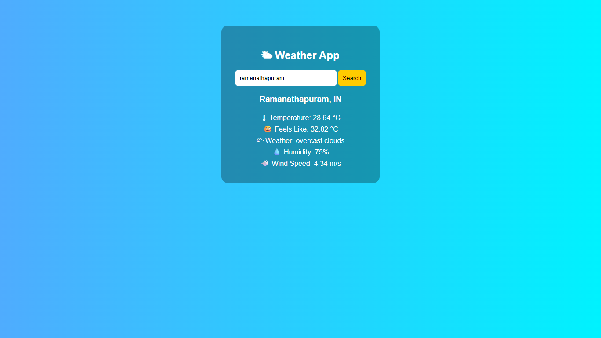

# 🌤 Weather App

A simple and responsive Weather Application built using **HTML, CSS, and JavaScript**. It uses the OpenWeatherMap API to fetch and display real-time weather information for cities in India.

## 🚀 Live Demo

[View Weather App](https://kamalitherasar.github.io/Weather-API/)

## ✨ Features

- Search for weather by city name.
- Display current temperature in Celsius.
- Show feels-like temperature.
- Display weather conditions and descriptions.
- Show humidity percentage.
- Display wind speed.
- Handle invalid city names.
- Responsive and simple user interface.

## 🛠️ Technologies Used

- HTML5 – Structure
- CSS3 – Styling and layout
- JavaScript – Functionality and API integration
- OpenWeatherMap API – Weather data

## 📸 Screenshot

Add your application screenshot to the repository and update the image path below.

```md

```

## 📂 Project Structure

```text
Weather-API/
│
├── index.html
├── style.css
├── script.js
└── README.md
├── images
    ├── weather-app.png
```

## ⚙️ How to Run Locally

1. Clone this repository:

   ```bash
   git clone https://github.com/KamalitherasaR/Weather-API.git
   ```

2. Open the project folder:

   ```bash
   cd Weather-API
   ```

3. Open `index.html` in your browser.

4. Enter a city name and click **Search** to view its weather information.

## 🌐 API Used

This project uses the [OpenWeatherMap Current Weather API](https://openweathermap.org/current) to retrieve weather information.

The application displays:
- Temperature
- Feels-like temperature
- Weather description
- Humidity
- Wind speed

## 👩‍💻 Author

**Kamalitherasa R**

- GitHub: [KamalitherasaR](https://github.com/KamalitherasaR)

---

⭐ If you like this project, consider giving it a star!
